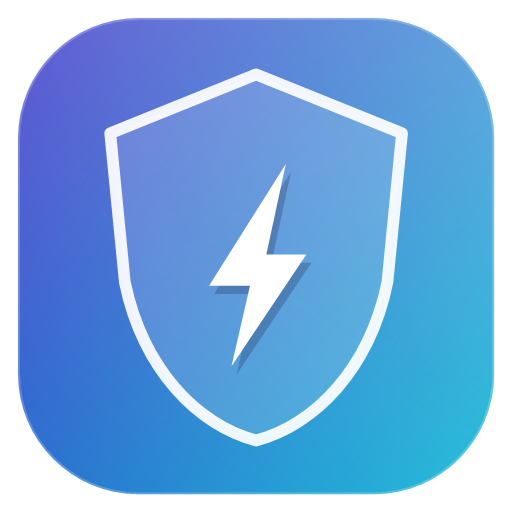
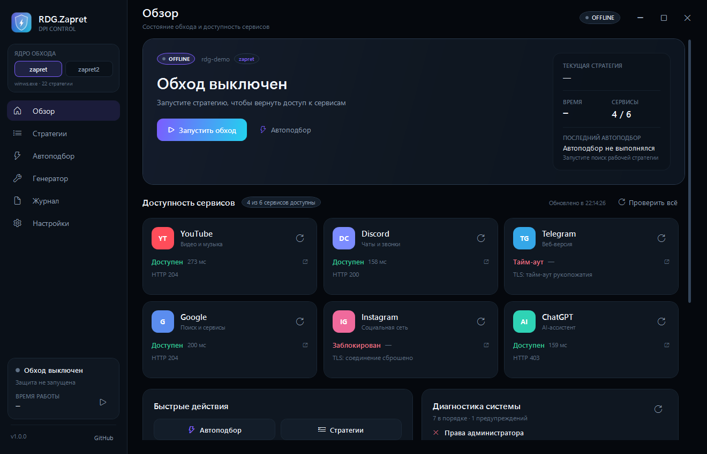
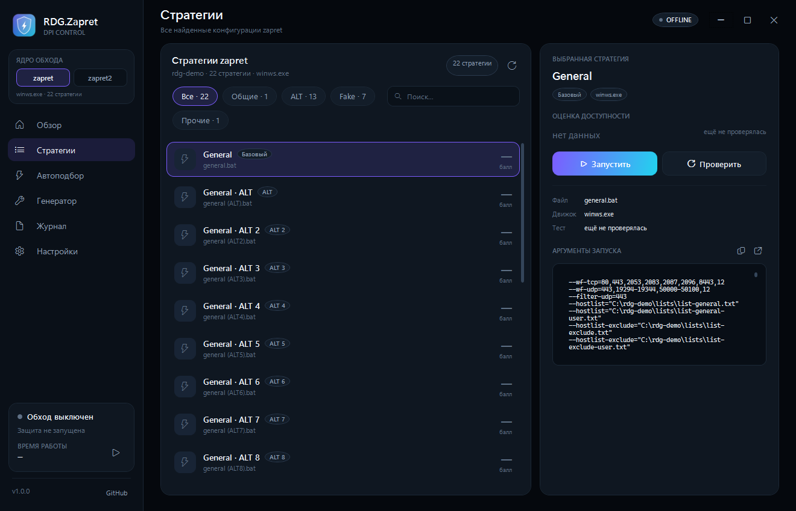
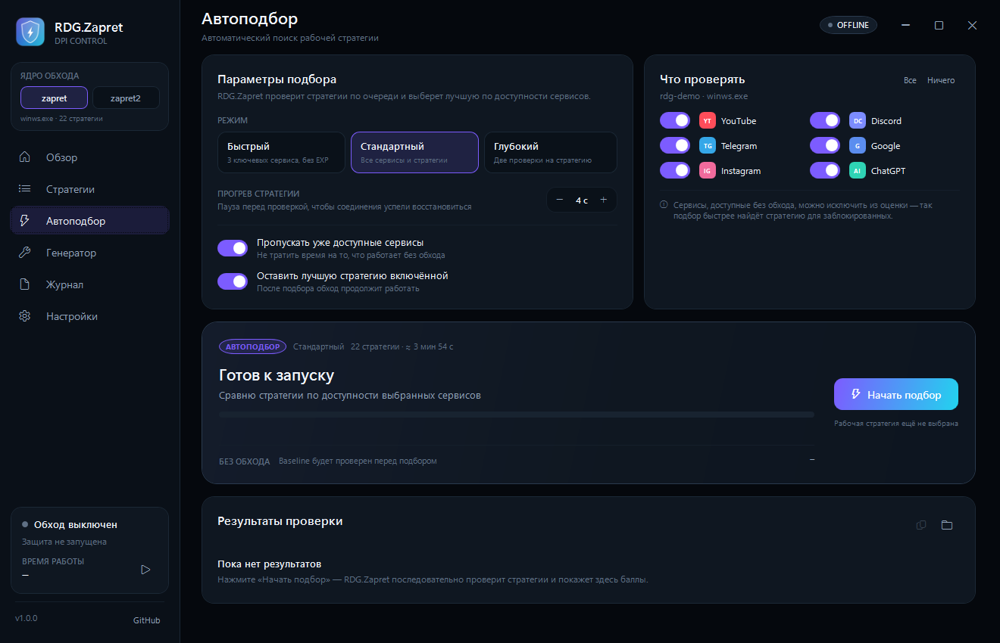
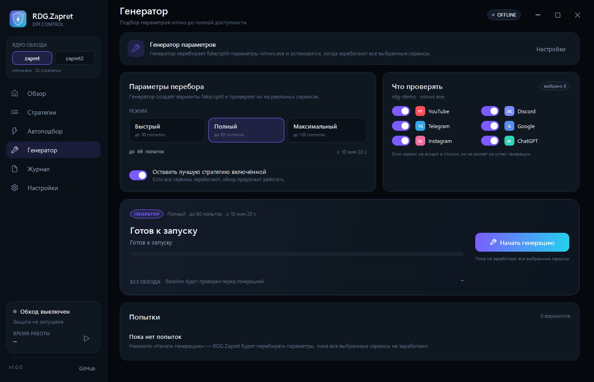
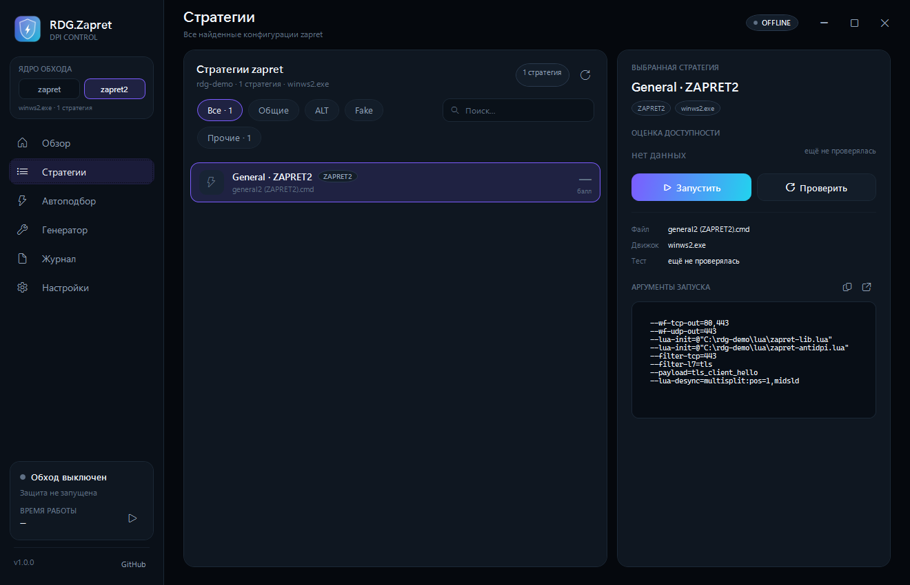

# RDG.Zapret

<p align="center">
  
</p>

<p align="center">
  <b>Современный графический менеджер <a href="https://github.com/bol-van/zapret2">zapret</a> для Windows</b><br/>
  Автоподбор рабочих стратегий, проверка доступности сервисов и понятная диагностика — без батников и чёрных консолей.
</p>



<sub>Скриншот: проверка без запущенного обхода — часть сервисов недоступна, как и должно быть.</sub>

## Возможности

- **Красивый тёмный интерфейс** на WPF (.NET 8): кастомный заголовок окна, аккуратные карточки, плавные состояния, 4 акцентные темы.
- **Выбор ядра обхода** — классический **zapret** (`winws.exe`) или новый **zapret2** (`winws2.exe`). Переключатель в левой панели и в настройках; показываются только стратегии выбранного ядра.
- **Автозагрузка стратегий с GitHub** — при отсутствии папки приложение само скачивает последний релиз Flowseal; кнопка «Скачать / обновить» доступна в настройках. Пользовательские списки сохраняются.
- **Автоматические новые стратегии** — при запуске приложение проверяет сервер обновлений и докидывает новые `.bat`-стратегии. Классические `winws`-стратегии ставятся в корень zapret, kinlay/`winws2` — в папку `zapret2`. Старые версии сохраняются в резервную копию, пользовательские файлы не затрагиваются.
- **Портативный режим** — все `.bat`/`.cmd` стратегии, лежащие рядом с `RDG.Zapret.exe`, подхватываются автоматически. Если рядом нет ядра zapret, оно скачивается в эту же папку (или в ProgramData, если папка только для чтения).
- **Трей** — крестик скрывает окно в системный трей; выход, запуск/остановка обхода и автоподбор доступны из меню иконки.
- **Фоновая проверка** — каждые N минут (1–120, по умолчанию 30) проверяет сервисы даже при свёрнутом окне. При сбое сначала делает несколько повторных проверок и только потом запускает фоновый подбор стратегии.
- **Генератор параметров** — перебирает fake/split-параметры `winws.exe` и не останавливается, пока не заработают все выбранные сервисы (или не закончится лимит попыток). Рабочая стратегия сохраняется в папку zapret.
- **Автоподбор по всем сервисам** — каждая стратегия полностью проверяется по всем выбранным сервисам (YouTube, Discord, Google, Cloudflare и своим сайтам). В результатах остаются только **стабильные** стратегии, где работают все выбранные сервисы.
- **Умный baseline** — сначала проверяет, что работает *без* обхода, и не тратит время на уже доступные сервисы. Регрессии (когда обход ломает работавший сервис) штрафуются.
- **Проверка доступности** YouTube, Discord, Google и Cloudflare: HTTP-запрос + классификация ошибок (тайм-аут, DNS, TLS-блокировка, сброс соединения). YouTube дополнительно проверяется по видео, Discord — по шлюзу, голосовым регионам и UDP-пути. Для ручных проверок показываются метрики **DNS / TCP / TTFB**.
- **Свои сайты в проверке** — в настройках можно добавить любой сервис по URL; он появится на «Обзоре» и станет доступен в автоподборе.
- **Проверка YouTube** — детектор медленного видео на реальных `googlevideo`-серверах, проверка конкретного ролика по ссылке, аккуратное исправление через `hosts` (только отдельный помеченный блок, с резервной копией и кнопкой отключения) и **YouTube QUIC fix** для доменов в `list-general-user.txt`.
- **Три режима подбора** — быстрый (короткий таймаут), стандартный (обычная проверка) и глубокий (две проверки каждой стратегии). В результатах остаются только стабильные стратегии.
- **Классификатор причин блокировки** — объясняет простыми словами: нет сети, проблема DNS, блокировка SNI/TLS, блокировка IP или сайт действительно недоступен. Из результата можно сразу добавить домен или IP в обход.
- **Доктор сети** — находит другие обходчики (GoodbyeDPI, ByeDPI, ciadpi), зависшие `winws`, проблемы DNS/ARP и драйвера WinDivert. Кнопка «Починить всё» выполняет безопасные исправления, не останавливая текущий обход RDG.Zapret.
- **DNS-менеджер** — переключение DNS на Cloudflare / Google / Quad9 / DHCP с резервной копией и откатом.
- **Свои домены и IP** — раздел «Списки»: домены в обход/напрямую, IP и подсети в обход/напрямую, массовая вставка и импорт из файла. Применяется после перезапуска обхода.
- **Стратегии сообщества** — 26 пресетов kinlay0 (MIT) и Lua-профили `yt4k` / `discord-light` добавляются в пакет zapret2 автоматически.
- **Прямое управление winws.exe / winws2.exe** — батники не запускаются через `cmd`, аргументы извлекаются и передаются движку напрямую. Это даёт чистые логи и полный контроль процесса.
- **Совместимость с пресетами Flowseal и kinlay0** — учитываются `utils/game_filter.enabled`, переменные `%BIN%`, `%LISTS%`, `%LUA%`, `%GameFilterTCP%`/`%GameFilterUDP%` и пользовательские списки.
- **Диагностика системы** на отдельной странице: права администратора, WinDivert, службы BFE/`zapret`, системный прокси, hosts, путь установки, конфликты и ремонт.
- **Журнал** с фильтрами, поиском, автоскроллом и выводом `winws`.
- **Автозапуск** через Планировщик задач Windows (с правами администратора, без лишнего UAC при входе).
- Поиск установленного zapret, в том числе по пути из службы `zapret`.
- Защита от конфликтов: если служба `zapret` запущена, приложение не станет молча убивать её процесс, а предложит остановить службу в настройках.

## Скриншоты

| Стратегии | Автоподбор |
|---|---|
|  |  |

| Генератор параметров |
|---|
|  |

## Требования

- Windows 10/11 x64.
- **Права администратора** — WinDivert не работает без них, поэтому манифест приложения требует повышение прав.
- [.NET 8 Desktop Runtime](https://dotnet.microsoft.com/download/dotnet/8.0) для framework-dependent сборки (или используйте self-contained).
- Распакованный zapret:
  - [Flowseal/zapret-discord-youtube](https://github.com/Flowseal/zapret-discord-youtube/releases/latest) — рекомендуется;
  - либо [bol-van/zapret-win-bundle](https://github.com/bol-van/zapret-win-bundle);
  - либо сборка с `winws2.exe` из [bol-van/zapret2](https://github.com/bol-van/zapret2).

## Быстрый старт

1. Скачайте архив zapret со страницы релизов и **распакуйте в папку без кириллицы и пробелов**, например `C:\zapret`.
   Если архив скачан из интернета, снимите галочку «Заблокировано» в свойствах файла.
   Либо нажмите **«Скачать автоматически»** — RDG.Zapret загрузит последний релиз с GitHub сам.
2. Запустите `RDG.Zapret.exe` и подтвердите UAC.
3. Укажите папку zapret в **Настройках** (или нажмите «Найти автоматически»). RDG.Zapret найдёт `bin\winws.exe`, `winws2.exe` и все пресеты. В левой панели выберите ядро: **zapret** или **zapret2**.
4. Нажмите **«Проверить всё»** на главной — увидите, какие сервисы доступны без обхода.
5. Откройте **«Автоподбор»**, выберите режим и нажмите **«Начать подбор»**.
6. Когда подбор закончится, стратегия запустится автоматически. Её можно поменять в разделе **«Стратегии»**.
7. При необходимости включите **«Запускать при входе в Windows»** в настройках.

> Совет: для YouTube и Discord в браузере включите Secure DNS (DoH) — например, `https://dns.google/dns-query`. Это не входит в zapret, но часто необходимо.

## Выбор ядра: zapret или zapret2



Переключатель **ЯДРО ОБХОДА** находится в левой панели и в разделе **Настройки → Запуск**:

- **zapret** — классическое ядро, файл `winws.exe`, пресеты `.bat` (Flowseal и аналоги).
- **zapret2** — новое Lua-ядро, файл `winws2.exe`, пресеты `.cmd` (bol-van/zapret2).

RDG.Zapret сканирует папку один раз и находит стратегии для обоих движков. Активное ядро определяет:

- какие стратегии показываются в списке и участвуют в автоподборе;
- какой движок будет запущен;
- счётчики и подсказки в интерфейсе.

Если в папке нет второго движка или для него нет пресетов, соответствующая кнопка отключается. Если выбранное ядро пропало из папки, приложение автоматически переключится на доступное и сохранит выбор.

Переключение **блокируется, пока обход запущен** или идёт проверка/автоподбор. Выбор ядра сохраняется между запусками и используется автозапуском.

## Автоматическая загрузка стратегий

- На первом запуске без папки zapret (и при включённой настройке «Автоматически скачивать zapret») приложение запрашивает последний релиз **Flowseal/zapret-discord-youtube** через GitHub API, с резервным вариантом через страницу релиза.
- Архив скачивается с прогрессом, распаковывается и устанавливается в `C:\ProgramData\RDG.Zapret\zapret`.
- Кнопка **«Скачать / обновить»** в настройках обновляет текущую папку. Перед заменой файлов показывается подтверждение.
- Пользовательские списки `lists/*-user.txt` и флаги `utils/*.enabled` сохраняются при обновлении.
- Для загрузки нужен доступ к GitHub. Если сеть блокирует GitHub, скачайте zip вручную и укажите папку.

## Свои домены и IP

Раздел **«Списки»** позволяет добавлять адреса без ручного редактирования файлов:

- **Сайты в обход** — домены, которые должны обрабатываться zapret (`lists/list-general-user.txt`).
- **Сайты напрямую** — домены, которые нужно исключить из обхода (`lists/list-exclude-user.txt`).
- **IP в обход** — IP или подсеть, которые нужно обрабатывать обходом. Хранятся в `lists/ipset-user.txt` и автоматически попадают в помеченную секцию `ipset-all.txt`.
- **IP напрямую** — IP или подсеть, которые нельзя трогать обходом (`lists/ipset-exclude-user.txt`).

Дополнительно:

- **Массовое добавление** — вставьте список доменов/IP в поле или импортируйте `.txt`.
- **Добавить в обход из проверки** — в «Диагностике» после проверки сайта появится кнопка добавления домена или IP в обход.

Для активного ядра используется своя папка `lists`: у классического zapret — в корне, у zapret2 — в `zapret2\lists`. После изменений нажмите **«Перезапустить обход»** или перезапустите стратегию вручную.

Домены вводятся без `https://` и пути: `example.com`. IP можно указывать как `1.2.3.4` или `10.0.0.0/8`.

## Обновление набора стратегий с сервера

При запуске RDG.Zapret проверяет сервер обновлений и ищет новый архив стратегий (по умолчанию — `strategies.zip` из раздела Zapret). Если архив изменился:

- классические `.bat` для `winws.exe` устанавливаются в корень zapret;
- kinlay/`winws2`-стратегии автоматически раскладываются в папку `zapret2` и получают имена `kinlay0 (...)`; пути `..\lists` / `..\lua` исправляются на локальные;
- каждый файл проверяется парсером. Если стратегия не разбирается, она не устанавливается;
- старые версии файлов сохраняются в `%LOCALAPPDATA%\RDG.Zapret\strategy-backups`;
- пользовательские файлы с другими именами не перезаписываются;
- после установки список стратегий обновляется автоматически.

Проверить вручную можно кнопкой **«Новые стратегии»** в разделе «Стратегии». Автопроверка отключается в настройках.

## Стратегии рядом с exe (портативная сборка)

RDG.Zapret поддерживает распространение в одной папке:

```text
RDG.Zapret.exe
1.bat
2.bat
...
86.bat
bin\winws.exe      ← необязательно
lists\             ← необязательно
utils\
```

- Все `.bat`/`.cmd` с упоминанием `winws` рядом с exe загружаются автоматически.
- Если рядом лежит полный zapret (`bin`, `lists`, `utils`), приложение использует эту папку как основную — ничего скачивать не нужно.
- Если рядом только стратегии, при первом запуске приложение скачает ядро zapret:
  - в папку с exe, если она доступна для записи;
  - иначе в `C:\ProgramData\RDG.Zapret\zapret`, после чего импортирует туда ваши стратегии.
- Стратегии с числовыми именами (`1.bat`, `2.bat`) показываются как **«Стратегия 1»**, **«Стратегия 2»** и т.д.
- Если ваши стратегии ссылаются на собственные файлы списков или fake-файлы (например `lists\wf-bf.txt`), положите папку `lists` и/или `bin` рядом с exe — иначе такие стратегии не запустятся.
- `build.ps1` по умолчанию **не удаляет** файлы в папке публикации, поэтому стратегии, `bin`, `lists`, `utils` сохраняются при пересборке и попадают в zip.
- Полная очистка папки публикации: `.\build.ps1 -Clean`.

## Два ядра: zapret и zapret2

В одной папке могут работать оба ядра:

- **zapret** — `winws.exe` + `.bat`-стратегии (Flowseal);
- **zapret2** — `winws2.exe` + `.cmd`-пресеты.

Если zapret2 ещё не установлен, просто нажмите **zapret2** в левом меню. Приложение:

1. скачает Windows-пакет zapret2 (~2 МБ);
2. распакует его в `<папка zapret>\zapret2`;
3. подготовит пресеты и включит новое ядро.

В пакет входит официальный `winws2.exe` из [bol-van/zapret2](https://github.com/bol-van/zapret2) v1.0.7, Lua-скрипты, 24 проверенных пресета, **26 стратегий сообщества kinlay0** (MIT: bol-van, Flowseal, kinlay0) и Lua-профили **YouTube 4K (yt4k)** и **Discord Light**. Классические `.bat`-стратегии и списки при этом не затрагиваются.

- Переключаться между ядрами можно в любой момент, когда обход остановлен.
- Обновить пакет: **Настройки → «Скачать / обновить zapret2»**.
- Если в пути к папке есть кириллица, `winws2` может ругаться на `chdir` — перенесите папку в путь без кириллицы.

## Трей и фоновый режим

- Кнопка **«крестик»** не закрывает приложение, а скрывает окно в системный трей. Выход — через правый клик по иконке → **«Выход»**.
- Отключить это поведение можно в настройках: **«Сворачивать в трей при закрытии»**.
- Из меню трея доступны: открыть окно, включить/выключить обход, автоподбор, генератор и выход.
- **Фоновая проверка** работает, даже когда окно скрыто. Интервал задаётся вручную: от 1 до 120 минут.
- Если запущен обход и сервис не отвечает **две проверки подряд**, приложение:
  - запускает фоновый подбор стратегии;
  - для классического `zapret` сначала пробует генератор параметров, затем готовые пресеты;
  - для `zapret2` перебирает готовые пресеты;
  - присылает уведомление в трей о старте и результате;
  - при неудаче возвращает предыдущую стратегию и делает паузу перед следующей попыткой.
- Автовосстановление работает только для стратегии, запущенной самим RDG.Zapret. Внешний `winws.exe` (например, служба) не останавливается.
- Если обход выключен, фоновая проверка только обновляет статусы, но не запускает стратегию автоматически.
- Уведомления показываются средствами Windows; при отключённых уведомлениях проверьте настройки системы.

## Telegram-прокси (TgWsProxy)

В приложение встроено управление [TgWsProxy](https://github.com/Flowseal/tg-ws-proxy) — локальным MTProto-прокси, который переносит Telegram через WebSocket и ускоряет загрузку там, где обычный трафик замедляется.

Раздел **Telegram** в левом меню:

- **Включить прокси** — запускает `TgWsProxy.exe` на `127.0.0.1:1443` (порт можно изменить).
- **Открыть в Telegram** — открывает `tg://proxy` и автоматически добавляет прокси.
- **Копировать ссылку** — если Telegram не открылся, отправьте ссылку себе в «Избранное» и нажмите её.
- **Новый секрет** — пересоздаёт MTProto-secret (после этого прокси в Telegram нужно подключить заново).
- **Скачать / обновить** — обновляет компонент с GitHub или с сервера обновлений.
- **Запускать вместе с RDG.Zapret** — автозапуск прокси при старте приложения.
- **Останавливать при выходе** — при закрытии RDG.Zapret управляемый прокси будет остановлен.

Особенности:

- TgWsProxy — отдельная программа Flowseal (MIT). У неё есть **своя иконка в трее**.
- Если TgWsProxy уже запущен отдельно (например, из автозагрузки), RDG.Zapret видит его как **«Внешний процесс»**, не останавливает и не запускает второй экземпляр (у программы общий мьютекс). Кнопка «Открыть в Telegram» при этом использует тот же secret.
- При первом запуске RDG.Zapret импортирует порт и secret из уже установленного `%APPDATA%\TgWsProxy\config.json`, поэтому после перехода на управляемый экземпляр Telegram продолжает работать без перенастройки.
- Компонент хранится в `%LOCALAPPDATA%\RDG.Zapret\tgwsproxy`; рядом лежит `TgWsProxy_data` с конфигом и журналом.
- Если `TgWsProxy.exe` лежит рядом с `RDG.Zapret.exe`, он используется как локальный источник и копируется в управляемую папку без скачивания.
- Прокси работает только локально и не является VPN; на другие программы не влияет.

## Автообновление

Приложение проверяет публичный манифест на вашем сервере обновлений:

```text
https://your-domain.example/zapret/version.json
```

Адрес задаётся одним из способов:

- файлом `update-endpoints.json` рядом с `RDG.Zapret.exe`:

  ```json
  { "baseUrl": "https://your-domain.example/zapret" }
  ```

  Шаблон лежит в корне репозитория: `update-endpoints.example.json`.
- переменной окружения `RDG_UPDATE_BASE_URL`.

Без настройки приложение использует заглушку `https://updates.example.com/zapret`
и не выполняет сетевых запросов за обновлениями.

- Проверка выполняется при запуске и каждые 6 часов; отключается в **Настройки → Обновления**.
- Если версия в манифесте новее установленной, приходит уведомление в трей, а в настройках появляется кнопка **«Скачать и установить»**.
- Файл скачивается, сверяется по **SHA-256** и только потом предлагается к установке. Старый exe сохраняется рядом как `RDG.Zapret.exe.bak`.
- Установка запускает отдельный PowerShell-хелпер: он ждёт завершения приложения, заменяет exe и снова запускает RDG.Zapret. Пароли FTP в клиент не встраиваются — обновления отдаются по HTTPS.
- Проверить вручную можно из меню трея: **«Проверить обновления»**.

Раскладка на сервере (полный шаблон — в папке `web/`):

```text
/zapret/version.json                    ← манифест
/zapret/RDG.Zapret.exe                  ← текущая версия
/zapret/releases/RDG.Zapret-1.10.1.exe  ← архив версий
/zapret/releases.json                   ← реестр версий
/zapret/strategies.zip                  ← пакет стратегий
/zapret/banner.json                     ← необязательный баннер
```

## Веб-часть для обновлений

В репозитории есть готовая папка `web/`:

- `admin.php` — публикация exe, zip со стратегиями и баннера;
- `index.php` — страница загрузки;
- `version.json`, `releases.json`, `banner.json` — формируются панелью;
- `config.example.php` — шаблон пароля (реальный `config.php` в git не попадает);
- `README.md` — развёртывание, форматы JSON и настройка клиента.

Панель пишет `version.json`, `releases.json`, `banner.json`, `RDG.Zapret.exe` и
`strategies.zip` в свой каталог. Никаких реальных доменов, FTP-паролей и ключей
в исходниках нет.

Если к релизу приложен `.zip` со стратегиями, панель прописывает его в поле `bundle`
файла `releases.json`. Приложение скачивает его относительно настроенного
`baseUrl`. Если `bundle` нет, используется `strategies.zip` из того же каталога.

## Баннер на главной

Приложение умеет показывать компактную карточку с заголовком, текстом, картинкой
и до двух кнопок-ссылок.

- По умолчанию баннер **выключен**, встроенной рекламы и ссылок в сборке нет.
- Включается через `banner.json` на вашем сервере обновлений.
- Управление — в `web/admin.php`.
- Если баннер выключен или сервер недоступен, карточка не показывается.

## Генератор параметров

Генератор — это отдельный инструмент для случая, когда готовые пресеты не дают полной доступности.

1. Выберите сервисы, которые должны работать.
2. Выберите режим: **Быстрый** (до 30 попыток), **Полный** (до 60) или **Максимальный** (до 120).
3. Запустите генерацию. Приложение создаёт варианты параметров `--dpi-desync`, `--dpi-desync-fooling`, позиции разбиения TLS, `seqovl`, TTL/autottl, количество повторов и fake-файлы.
4. Каждый вариант запускается на реальном `winws.exe`, проверяется baseline и все выбранные сервисы.
5. Как только **все выбранные сервисы** отвечают, генерация останавливается. Рабочая стратегия сохраняется как `general (RDG generated).bat` и появляется в разделе «Стратегии». Её можно сразу применить.
6. Если лимит попыток закончился, лучший частичный результат можно сохранить и применить вручную.

Особенности:

- Генератор работает с ядром **zapret** (`winws.exe`). Для zapret2 используйте автоподбор готовых `.cmd`-пресетов.
- Сгенерированная стратегия применяется ко всему HTTPS-трафику (443, 8443 и альтернативные порты), без hostlist-ов — это универсальный fallback, но он может нагружать CPU сильнее обычных пресетов.
- Текущий обход останавливается на время проверки. Не запускайте генератор одновременно с автоподбором или ручным тестом — приложение блокирует такие операции.

## Как работает автоподбор

1. Останавливает текущий обход и проверяет сервисы **без** zapret (baseline).
2. Для каждой выбранной стратегии:
   - запускает `winws.exe`/`winws2.exe` с аргументами из пресета;
   - ждёт прогрева;
   - проверяет **все выбранные сервисы** (в глубоком режиме — дважды);
   - считает балл и проверяет, что каждый выбранный сервис полностью доступен.
   При включённом «Только лучшие варианты» берутся 10 лучших по прошлым результатам + новые; отключите, чтобы проверять всё.
3. Останавливает движок между пресетами, чтобы проверки были честными.
4. В результатах показывает **только стабильные стратегии** — те, где доступны все выбранные сервисы. Если хотя бы один сервис недоступен, стратегия не считается рабочей.
5. Выбирает лучшую стабильную и (по настройке) оставляет её включённой.
6. Сохраняет отчёт в `%LOCALAPPDATA%\RDG.Zapret\last-tune.json`; его можно скопировать в Markdown из интерфейса.

Если ждать не хочется:

- нажмите **«Остановить подбор»** — уже проверенные результаты останутся;
- лучшую стабильную можно применить кнопкой **«Применить»** в строке результата или общей кнопкой;
- либо откройте раздел **«Стратегии»** и выберите любую вручную.

Стратегии, которые не запустились или не дали доступа ни к одному сервису, автоматически попадают в исключённые. Вернуть их можно кнопкой **«Вернуть исключённые»** на странице автоподбора.

Режимы:

| Режим | Что делает |
|---|---|
| Быстрый | Все стратегии, все выбранные сервисы, короткий таймаут |
| Стандартный | Все стратегии, все выбранные сервисы, обычный таймаут |
| Глубокий | Все стратегии, все выбранные сервисы, две проверки |

## Проверка сервисов

- Запросы идут **напрямую**, без системного прокси.
- **YouTube** проверяется по странице видео: приложение ищет `playabilityStatus: OK` и `streamingData`. Главная страница может открываться, но если видео недоступно — сервис получает статус «частично».
- **Discord** проверяется глубже обычного HTTP: API, WebSocket-шлюз реального времени, голосовые регионы и UDP/STUN-путь для голоса. Если приложение и шлюз работают, а UDP недоступен — статус «частично», с пояснением про голос.
- Дополнительно проверяется **`voice.discord.gg`**: DNS, TCP и TLS. Если этот служебный адрес не публикует запись в вашей сети, это не считается ошибкой — основной голосовой путь проверяется через API голосовых регионов.
- На главной странице для ручных проверок показываются метрики **DNS / TCP / TTFB**.
- Остальные сервисы проверяются HTTP-запросом; при ошибке выполняется TLS-проба, чтобы отличить «сайт недоступен» от «SNI заблокирован».
- Поддерживаются HTTP 2xx/3xx/4xx как «сервис отвечает»; 5xx и 451 считаются частичной доступностью.
- Фоновая проверка реагирует на «частично» у YouTube и Discord: если видео или голос перестали работать, сначала выполняются несколько повторных проверок, и только затем запускается фоновое восстановление.

## Медленный YouTube и проблемные видео

Иногда YouTube открывается, шортсы работают, но конкретный ролик не грузится ни с одной стратегией. Обычно это значит, что видео отдаёт CDN-сервер `googlevideo.com`, который режут по IP или по QUIC.

На главной странице есть карточка **«YouTube»**:

1. **«Проверить скорость видео»** — скачивает фрагмент с нескольких реальных серверов YouTube и показывает скорость.
2. **«Проверить видео»** — вставьте ссылку на проблемный ролик (или его 11-символьный ID). Приложение запросит у YouTube именно серверы этого видео и проверит каждый из них.
3. Если найдены медленные или недоступные серверы, появится кнопка **«Исправить»**. Она добавляет в `hosts` только отдельный помеченный блок с адресами вида `127.0.0.2 rrN---sn-*.googlevideo.com` — плеер быстрее переключится на рабочий сервер.
4. **«YouTube QUIC fix»** — добавляет `youtube.com`, `googlevideo.com`, `ytimg.com`, `ggpht.com` и `youtube-nocookie.com` в `list-general-user.txt` и перезапускает обход. Это нужно, потому что QUIC-секция стратегий использует `list-general`, а не `list-google`.
5. После QUIC fix **отключите QUIC/HTTP3 в браузере** и перезапустите его:
   - Chrome/Edge: `chrome://flags/#enable-quic` (или `edge://flags/#enable-quic`) → **Disabled**;
   - Firefox: `about:config` → `network.http.http3.enable` → **false**.

Перед изменением `hosts` создаётся резервная копия в `%LOCALAPPDATA%\RDG.Zapret`. Исправление никогда не включается само: только по вашему нажатию и с подтверждением. Кнопка **«Убрать исправление»** удаляет только помеченный блок.

## Доктор сети

Страница **«Диагностика»** проверяет:

- другие обходчики: GoodbyeDPI, ByeDPI, ciadpi, spoofdpi;
- службу `zapret` и зависшие процессы `winws`/`winws2` (текущий обход RDG.Zapret не трогается);
- DNS, базовое соединение с интернетом, ARP-кэш и TCP Timestamps;
- драйвер WinDivert;
- DNS-серверы: текущие, смена на Cloudflare/Google/Quad9/DHCP, откат;
- почему не открывается конкретный сайт: нет сети, DNS, SNI, IP, сервер недоступен.

Исправления выполняются только по кнопке: сбросить DNS-кэш, очистить ARP, включить TCP Timestamps, остановить мешающие программы или перезапустить драйвер. Кнопка **«Починить всё»** делает безопасный набор этих действий, не останавливая текущий обход RDG.Zapret. Без прав администратора часть действий недоступна.

## Поддерживаемые пресеты

RDG.Zapret не исполняет `.bat` через командную строку. Он разбирает файл и запускает движок напрямую:

- `general*.bat` из Flowseal — все варианты ALT/FAKE/SIMPLE/EXP;
- `preset*.cmd` из zapret-win-bundle;
- `.cmd`-пресеты с `winws2.exe` (zapret2);
- 26 пресетов **kinlay0** — DOUBLE FAKE, SINGLE FAKE, HOSTFAKESPLIT TS, EXP1–5, CIRCULAR и другие;
- Lua-профили **YouTube 4K (yt4k)** и **Discord Light** для zapret2;
- `general (RDG generated).bat` — стратегия, созданная генератором параметров.

В списке отображаются только пресеты **выбранного ядра**. Например, при выборе zapret2 `.bat`-стратегии Flowseal скрываются, а `winws.exe` не запускается.

Учитываются:
- `%~dp0`, `%~n0`, `set "VAR=..."`, переменные окружения;
- `%GameFilterTCP%` / `%GameFilterUDP%` из `utils/game_filter.enabled`;
- создание пустых `lists/*-user.txt`, как это делает `service.bat`.

Если пресет не удалось разобрать, причина пишется в журнал (обычно это отсутствующий движок или неизвестная переменная).

## Сборка

Нужен [.NET 8 SDK](https://dotnet.microsoft.com/download/dotnet/8.0).

```powershell
dotnet build src/RDG.Zapret/RDG.Zapret.csproj -c Release
```

Запуск из исходников (удобнее из терминала, запущенного от администратора):

```powershell
dotnet run --project src/RDG.Zapret/RDG.Zapret.csproj
```

Для отладки без UAC (некоторые функции будут недоступны):

```powershell
dotnet build src/RDG.Zapret/RDG.Zapret.csproj -p:NoElevation=true
```

### Публикация

```powershell
# framework-dependent single-file (нужен .NET 8 Desktop Runtime)
.\build.ps1

# self-contained single-file (ничего дополнительно не нужно, ~150 МБ)
.\build.ps1 -SelfContained
```

По умолчанию публикация **сохраняет** уже лежащие в `artifacts\RDG.Zapret-win-x64` стратегии и файлы zapret. Для полной очистки используйте `.\build.ps1 -Clean`.

Готовый файл: `artifacts\RDG.Zapret-win-x64\RDG.Zapret.exe`, zip-архив со стратегиями — рядом.

## Структура проекта

```
src/RDG.Zapret/
  App.xaml, MainWindow.xaml        # точка входа и оболочка
  Models/                          # настройки, пресеты, результаты, отчёты
  Services/                        # парсер пресетов, запуск winws, пробы, тюнер, диагностика
  ViewModels/                      # MVVM-логика страниц
  Views/                           # Dashboard / Strategies / Autotune / Logs / Settings
  Styles/Theme.xaml                # дизайн-система
  Infrastructure/                  # команды, конвертеры, утилиты
  Assets/                          # иконка и логотип
tools/make-icon.ps1                # перегенерация иконки
build.ps1                          # публикация
```

## Безопасность и ограничения

- Приложение **требует права администратора** и работает с драйвером WinDivert — это необходимо для обхода DPI.
- RDG.Zapret не устанавливает драйверы и не меняет системные файлы. Исключения:
  - создаёт недостающие `lists/*-user.txt` в папке zapret;
  - по явному действию пользователя создаёт/удаляет задачу автозапуска;
  - по явному действию кнопки **«Исправить»** добавляет/удаляет только помеченный блок в `hosts` (с резервной копией) для медленных серверов YouTube;
  - по явному действию кнопки **«YouTube QUIC fix»** добавляет домены YouTube в `lists/list-general-user.txt` и перезапускает обход;
  - по явному действию кнопки «Остановить службу zapret» останавливает и удаляет службу, установленную через `service.bat`.
- WinDivert может реагировать антивирус. Добавьте папку zapret в исключения, если это необходимо.
- Автоматическая загрузка заменяет файлы в папке zapret. Перед обновлением показывается подтверждение; пользовательские списки `lists/*-user.txt` сохраняются.
- Генератор и автоподбор останавливают текущий обход на время проверки. Перед запуском генератора при работающем обходе запрашивается подтверждение.
- Если служба `zapret` уже запущена, ручной запуск и автоподбор блокируются, чтобы не конфликтовать. Остановите службу в разделе **«Диагностика»**.
- Смена ядра во время работы обхода блокируется — сначала остановите обход.
- Стратегии со временем перестают работать. Обновляйте zapret и пресеты, запускайте автоподбор повторно.
- Проект не связан с Flowseal и bol-van. Используйте на свой риск.

## Если что-то не работает

| Проблема | Что проверить |
|---|---|
| «Не найден winws.exe» | Укажите корень распакованного архива, рядом с ним должна быть папка `bin` |
| `winws.exe` сразу завершается | Запустите RDG.Zapret от администратора, проверьте антивирус и конфликт службы `zapret` |
| Ничего не разблокируется | Смените стратегию, включите Secure DNS, проверьте системный прокси и hosts |
| YouTube открывается, но видео тормозит | Главная → «Проверить скорость видео». Если найдены медленные серверы — «Исправить»; если проверка не проходит — включите обход и запустите автоподбор |
| Конкретное видео не грузится ни с одной стратегией | Главная → вставьте ссылку в «Проверить видео» → «Исправить» для проблемных серверов; затем «YouTube QUIC fix» и отключите QUIC/HTTP3 в браузере |
| Непонятно, почему сайт не открывается | Откройте «Диагностика» → «Почему сайт не открывается?», введите домен и нажмите «Проверить сайт» |
| Проверка показывает тайм-ауты | Увеличьте тайм-аут в настройках, проверьте сеть; отсутствие обхода ожидаемо для заблокированных сервисов |
| Стратегии рядом с exe не появились | Убедитесь, что это `.bat`/`.cmd` с `winws`, и запустите приложение из этой папки; при отсутствии ядра включите автозагрузку |
| Не видно нужного ядра | В папке нет `winws2.exe` или пресетов для него; кнопка zapret2 будет отключена |
| В списке нет стратегий | Проверьте, что выбрано правильное ядро, и нажмите «Обновить» в разделе «Стратегии» |
| Автозагрузка не работает | Проверьте доступ к GitHub, включите настройку «Автоматически скачивать zapret» или укажите папку вручную |
| Генератор не находит стратегию | Увеличьте лимит попыток, выберите меньше сервисов, проверьте базовую доступность сети; для zapret2 генератор недоступен |
| Окно не закрывается по крестику | Так задумано: включено «Сворачивать в трей». Выход — через меню иконки в трее |
| Фоновый подбор не запускается | Автовосстановление работает только при активном обходе, запущенном из приложения; проверьте настройки фоновой проверки |
| Не приходит обновление | Проверьте `update-endpoints.json` и доступ к `version.json` на вашем сервере, откройте Настройки → Обновления и нажмите «Проверить»; в манифесте версия должна быть выше установленной |
| Обновление не устанавливается | Приложению нужны права администратора и доступ на запись в свою папку; старый exe сохраняется как `RDG.Zapret.exe.bak` |
| Telegram-прокси не включается | Если прокси уже запущен отдельной программой, закройте его через её иконку в трее; проверьте, что порт 1443 не занят |
| Telegram не подключается после смены секрета | Нажмите «Открыть в Telegram» заново или скопируйте ссылку и отправьте себе в «Избранное» |
| TgWsProxy не скачивается | Положите `TgWsProxy.exe` рядом с `RDG.Zapret.exe` — приложение использует локальный файл |
| Не переключается на zapret2 | Нажмите кнопку zapret2 — приложение само скачает и установит ядро. Если не получилось, проверьте интернет и повторите; обновление вручную — в Настройках |
| Стратегия падает с `could not read ...bin` | В папке `bin` нет fake-файла, который использует стратегия; добавьте его (например, `quic_initial_dbankcloud_ru.bin`) |
| В журнале `failed to split command line options from file` | Обновитесь до 1.5.1 или новее: исправлен формат `@config` для zapret2 |
| Не работает Discord | Остановите Adguard/Killer/Intel Connectivity, очистите кэш Discord через `service.bat` |
| Не запускается автозапуск | Проверьте задачу `RDG.Zapret` в Планировщике задач, она должна работать с повышенными правами |
| Приложение не стартует | Нужен .NET 8 Desktop Runtime (для framework-dependent сборки) и Windows 10/11 x64 |

Журнал: `%LOCALAPPDATA%\RDG.Zapret\logs`.

## Лицензия

MIT — см. [LICENSE](LICENSE).

Огромная благодарность:
- [bol-van](https://github.com/bol-van) — за zapret и zapret2;
- [Flowseal](https://github.com/Flowseal) — за удобные пресеты и документацию.
